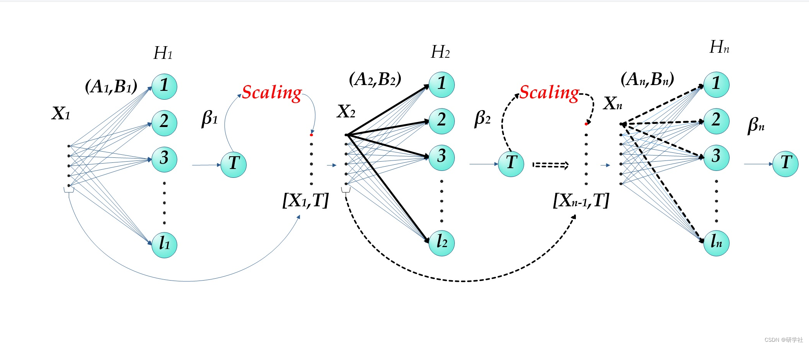
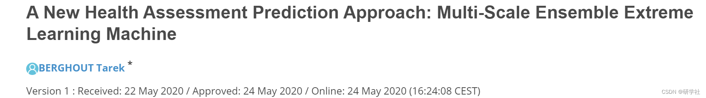
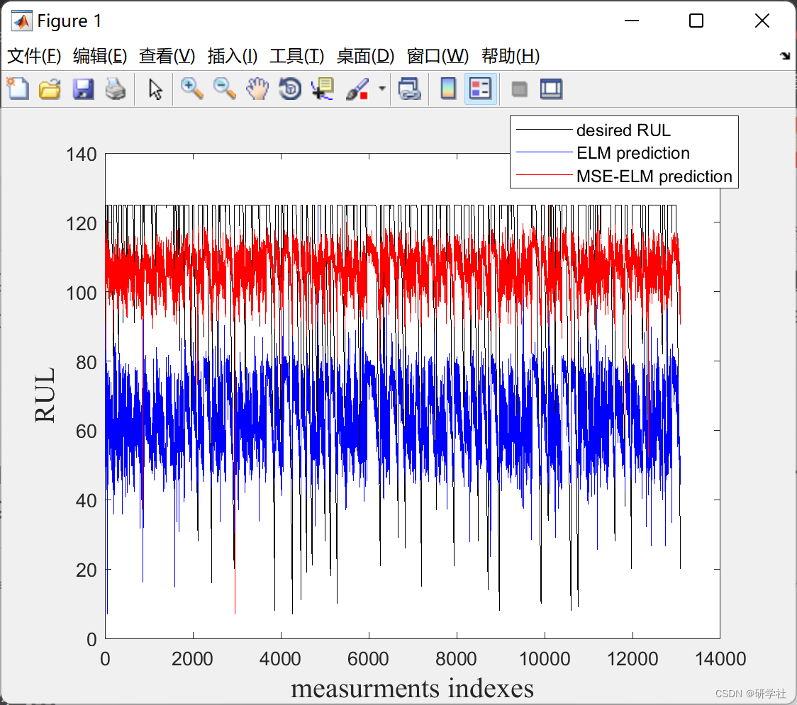
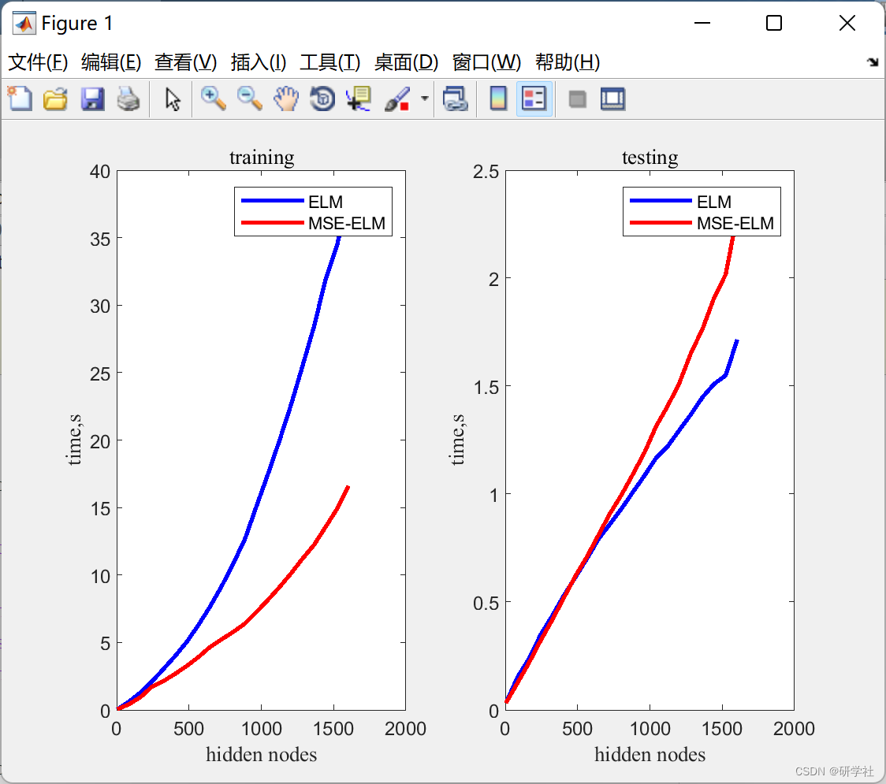
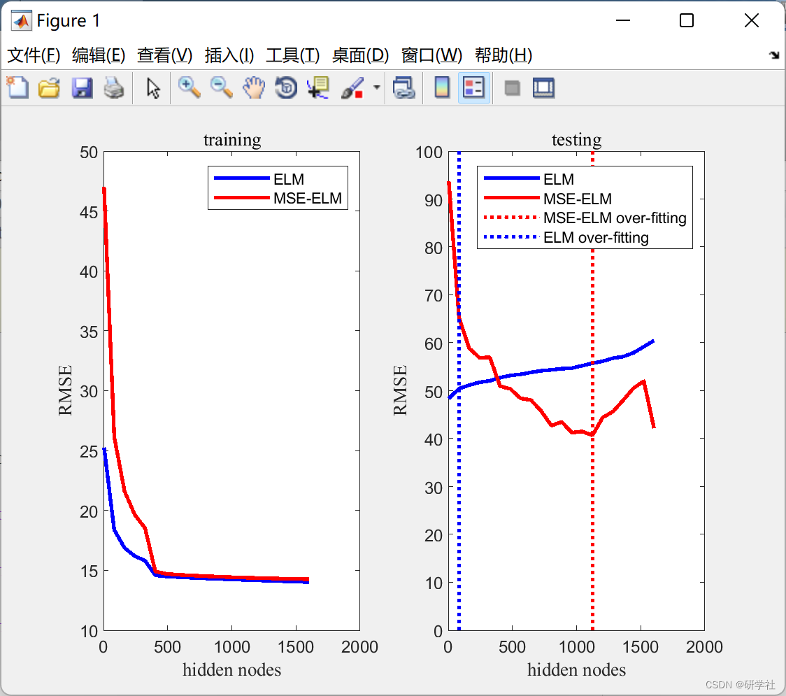

# Multi-scale ensemble extreme learning machine regression (Matlab code implementation)

💥💥💞💞 Welcome to this blog❤️❤️💥💥
🏆 Bloggers' Advantages: 🌞🌞🌞 The content of the blog strives for rigorous thinking and clear logic, facilitating readers.
⛳️ Mantra: A journey of a thousand miles is begun with a single step. 1 Overview📚2 Run results🎉3 References🌈4 Matlab code and detailed reading of articles
💥1 Overview Remaining useful life (RUL) of complex systems based on traditional predictive paradigms (such as physical modeling) can be considered a very challenging task, requiring deep understanding of system components and their internal interactions. Moreover, most physical models are built under limited conditions, which is an appropriate explanation [1]. Today, due to the continuous development of sensor technology and the availability of historical operating system data, machine learning (ML) tools have gained increasing attention. Replacing classic predictive paradigms with training tools is an appropriate solution to reduce complexity and human intervention.
​Edit
This article can be considered as the first step in designing future competitive data-driven methods for predicting the remaining useful life of aircraft engines. The proposed method is a collection of sequentially connected extreme learning machines. The prediction results of the first network are scaled and fed as additional features to the input of the next network. This feature mapping allows for increased relevance between the training input and its target by maintaining new prior knowledge about the possible behavior of the objective function. Using a set of "time-varying" data retrieved from the NASA public dataset C-MAPSS (Commercial Modular Aircraft Propulsion System Simulation), the proposed method was evaluated against basic extreme learning machines. Performance comparisons were made with the basic extreme learning machine, demonstrating the effectiveness of the proposed method.
​Edit
📚2 Run results
​Edit
Partial code:
clear all  
clc  
addpath('codes')  
randn('state',0);  
%%  
load ('data.mat')  
%% define options
Nlayers=4;  
H=zeros(1,Nlayers);  
c=0;  
%%  
for i=1:20:400+1;  
i  
H(:,:)=i;  
c=c+1;  
node(c)=sum(H);  
Options.Layers=H;  
Options.N=sum(Options.Layers);  
% Apllication  
[net]=ELM(x,y,xt,yt,Options);  
tr_acc(c)=net.tr_acc;  
ts_acc(c)=net.ts_acc;  
tr_time(c)=net.tr_time;  
ts_time(c)=net.ts_time;  
[net2]=MSELM(x,y,xt,yt,Options);  
tr_acc2(c)= net2.tr_acc;  
ts_acc2(c)= net2.ts_acc;  
tr_time2(c)=net2.tr_time;  
ts_time2(c)=net2.ts_time;  
end  
%%  
save('results')  
%clear all  
%clc  
load('results.mat')  
%% plot  
f=10;  
subplot(121)  
plot(node,smooth(tr_time,f)...  
,'b',node,smooth(tr_time2,f),'r'...  
,'LineWidth',2)  
legend('ELM','MSE-ELM');  
xlabel('hidden nodes','FontName','Times New Roman','FontSize',10)  
ylabel('time,s','FontName','Times New Roman','FontSize',10)  
title('training','FontName','Times New Roman','FontSize',10)  
%  
subplot(122)  
plot(node,smooth(ts_time,f)...  
,'b',node,smooth(ts_time2,f),'r'...  
,'LineWidth',2)  
legend('ELM','MSE-ELM');  
xlabel('hidden nodes','FontName','Times New Roman','FontSize',10)  
ylabel('time,s','FontName','Times New Roman','FontSize',10)  
title('testing','FontName','Times New Roman','FontSize',10)  
%  
🎉3 References
🌈4 Matlab code and article detailed reading

## Images

<!-- PAYMENT_BLOCK -->

## Get this dataset

- Payment link (Stripe): [Buy now](https://buy.stripe.com/3cs8yP7sY87d0vu9AB)
- Payment QR code: 

<!-- /PAYMENT_BLOCK -->
